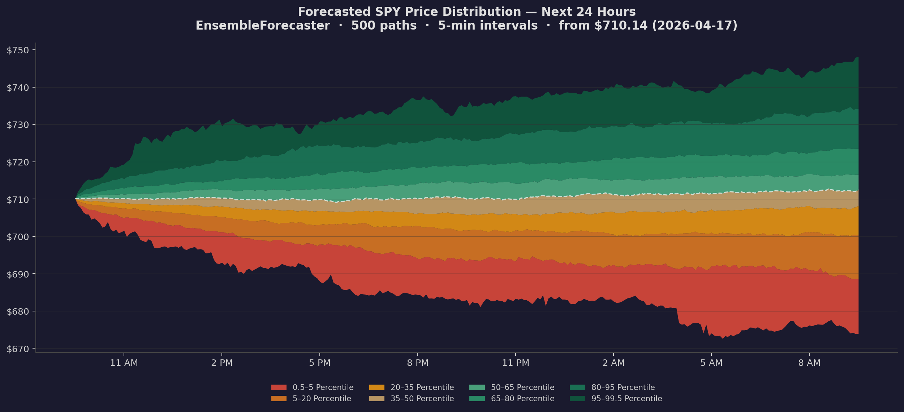

# SynthQuant Engine


**SynthQuant** is a production-grade synthetic financial data generation and probabilistic forecasting platform. It combines regime detection, stochastic volatility models, Monte Carlo simulation, and risk analytics into a unified, extensible Python framework.

<p align="center">
  
</p>

<p align="center"><em>21-trading-day probabilistic price forecast for SPY from the default model, GJR-GARCH with skew-t innovations (<code>synthquant.forecast_prices</code>). Percentile bands show the full predicted distribution; the asymmetric fan comes from the leverage effect, which raises volatility after down days. Regenerate with <code>python scripts/generate_fan_chart.py</code>.</em></p>

---

## Showcase

### VaR Backtesting — Model Progression

Walk-forward VaR backtest on SPY (2014–2026, 3,088 days). Each model is re-fit every 21 days on a rolling 504-day window.

> **GJR-skewt** is the only model that passes all regulatory and statistical tests at the 1% level.

<table>
<thead>
<tr>
<th colspan="6">1% VaR Model Comparison &nbsp;·&nbsp; Expected violations ≈ 31 / 3,088 days</th>
</tr>
<tr>
<th>Model</th>
<th align="center">Violations</th>
<th align="center">Rate</th>
<th align="center">Kupiec <i>p</i></th>
<th align="center">Christoffersen <i>p</i></th>
<th align="center">Basel Zone</th>
</tr>
</thead>
<tbody>
<tr>
<td>Historical</td>
<td align="center">53</td>
<td align="center">1.72%</td>
<td align="center">0.000</td>
<td align="center">0.000</td>
<td align="center"></td>
</tr>
<tr>
<td>Normal</td>
<td align="center">91</td>
<td align="center">2.95%</td>
<td align="center">0.000</td>
<td align="center">0.000</td>
<td align="center"></td>
</tr>
<tr>
<td>Student-t</td>
<td align="center">62</td>
<td align="center">2.01%</td>
<td align="center">0.000</td>
<td align="center">0.000</td>
<td align="center"></td>
</tr>
<tr>
<td>GARCH-Normal</td>
<td align="center">68</td>
<td align="center">2.20%</td>
<td align="center">0.000</td>
<td align="center">0.689</td>
<td align="center"></td>
</tr>
<tr>
<td><b>GJR-skewt</b></td>
<td align="center"><b>40 ✅</b></td>
<td align="center"><b>1.30%</b></td>
<td align="center"><b>0.115 ✅</b></td>
<td align="center"><b>0.547 ✅</b></td>
<td align="center"></td>
</tr>
<tr>
<td>GJR-VIX</td>
<td align="center">16</td>
<td align="center">0.52%</td>
<td align="center">0.003</td>
<td align="center">1.000</td>
<td align="center"></td>
</tr>
</tbody>
</table>

<details>
<summary><b>Crisis Period Performance (COVID, 2022 Bear, Aug 2024)</b></summary>
<br>

**COVID Crash** (Feb–Mar 2020, 24 trading days)

| Model | Violations | Rate | Worst Loss | VaR @ Worst | |
|:------|:----------:|:----:|:----------:|:-----------:|:--|
| Normal | 12 | 50.0% | −10.94% | −2.49% | ← missed half the days |
| **GJR-skewt** | **1** | **4.2%** | −10.94% | **−19.41%** | ← caught the crash |
| GJR-VIX | 1 | 4.2% | −10.94% | −17.79% | |

**2022 Bear Market** (Jan–Oct, 196 trading days)

| Model | Violations | Rate | Worst Loss | VaR @ Worst |
|:------|:----------:|:----:|:----------:|:-----------:|
| Normal | 12 | 6.1% | −4.35% | −2.59% |
| **GJR-skewt** | **3** | **1.5%** | −4.35% | **−3.51%** |
| GJR-VIX | 1 | 0.5% | −4.35% | −3.89% |

</details>

### Monte Carlo Option Pricing

European call prices and implied volatility surface across 13 strikes × 3 maturities, comparing GJR-GARCH, Heston stochastic vol, and Black-Scholes.

<table>
<thead>
<tr>
<th colspan="6">Implied Volatility Smile &nbsp;·&nbsp; 63-day maturity &nbsp;·&nbsp; SPY @ $710.67</th>
</tr>
<tr>
<th align="center">Moneyness</th>
<th align="center">Black-Scholes</th>
<th align="center">GARCH</th>
<th align="center">Heston</th>
<th align="center">GARCH − BS</th>
<th>Observation</th>
</tr>
</thead>
<tbody>
<tr><td align="center">85%</td><td align="center">13.3%</td><td align="center">48.1%</td><td align="center">15.9%</td><td align="center">+34.8 pp</td><td>Deep OTM put skew</td></tr>
<tr><td align="center">90%</td><td align="center">13.3%</td><td align="center">39.7%</td><td align="center">15.4%</td><td align="center">+26.4 pp</td><td></td></tr>
<tr><td align="center">95%</td><td align="center">13.3%</td><td align="center">32.1%</td><td align="center">14.4%</td><td align="center">+18.8 pp</td><td></td></tr>
<tr><td align="center"><b>100%</b></td><td align="center"><b>13.3%</b></td><td align="center"><b>25.7%</b></td><td align="center"><b>13.4%</b></td><td align="center"><b>+12.4 pp</b></td><td><b>ATM</b></td></tr>
<tr><td align="center">105%</td><td align="center">13.3%</td><td align="center">20.7%</td><td align="center">13.9%</td><td align="center">+7.4 pp</td><td></td></tr>
<tr><td align="center">110%</td><td align="center">13.3%</td><td align="center">17.7%</td><td align="center">15.0%</td><td align="center">+4.4 pp</td><td>OTM call wing</td></tr>
<tr><td align="center">115%</td><td align="center">13.3%</td><td align="center">17.1%</td><td align="center">15.9%</td><td align="center">+3.8 pp</td><td>Smile uptick</td></tr>
</tbody>
</table>

> **Key insight**: GJR-GARCH naturally produces the volatility skew observed in real options markets — OTM puts are expensive because asymmetric GARCH makes negative returns increase vol more than positive returns. Black-Scholes (flat vol) misses this entirely.

<details>
<summary><b>Greeks & Exotic Options</b></summary>
<br>

**Greeks** (3-month ATM call)

| | Black-Scholes | GARCH | Heston |
|:-----|:----------:|:-----:|:------:|
| Delta | 0.577 | 0.784 | 0.599 |
| Gamma | 0.00828 | 0.00512 | 0.01042 |
| Vega | 139.1 | 210.4 | 167.1 |

**Exotic Options** (3-month, GARCH model)

| Type | Price | vs European |
|:-----|------:|:-----------:|
| European Call | $40.10 | baseline |
| Asian Call (avg price) | $21.11 | −47.4% |
| Down-Out Put (B=640) | $3.19 | −75.7% |
| Up-Out Call (B=782) | $15.90 | −60.4% |

</details>

### Stress Testing & Scenario Analysis

Portfolio stress test (SPY 60% / TLT 30% / GLD 10%) using GARCH-calibrated scenarios with decaying vol shocks over a 63-day horizon.

<table>
<thead>
<tr>
<th colspan="5">Portfolio Risk Under Stress &nbsp;·&nbsp; 63-day horizon &nbsp;·&nbsp; 10,000 MC paths</th>
</tr>
<tr>
<th>Metric</th>
<th align="center">Normal</th>
<th align="center">Vol 2×</th>
<th align="center">COVID 3×</th>
<th align="center">GFC 4×</th>
</tr>
</thead>
<tbody>
<tr><td>VaR 1%</td><td align="center">−18.9%</td><td align="center">−25.6%</td><td align="center">−29.5%</td><td align="center">−32.0%</td></tr>
<tr><td>CVaR 1%</td><td align="center">−28.8%</td><td align="center">−35.4%</td><td align="center">−37.4%</td><td align="center">−39.8%</td></tr>
<tr><td>Median Max DD</td><td align="center">−3.9%</td><td align="center">−5.5%</td><td align="center">−7.2%</td><td align="center">−8.8%</td></tr>
<tr><td>Worst Max DD (1%)</td><td align="center">−29.7%</td><td align="center">−37.0%</td><td align="center">−43.1%</td><td align="center">−45.8%</td></tr>
<tr><td>P(loss > 10%)</td><td align="center">3.5%</td><td align="center">5.9%</td><td align="center">7.5%</td><td align="center">9.2%</td></tr>
<tr><td>P(loss > 20%)</td><td align="center">0.9%</td><td align="center">1.8%</td><td align="center">2.5%</td><td align="center">3.5%</td></tr>
</tbody>
</table>

<blockquote>
<b>Historical validation</b><br>
✅ <b>GFC</b> (49 days): −22.6% portfolio loss → exceeds Vol 2× VaR scenario<br>
✅ <b>COVID</b> (24 days): −17.5% portfolio loss → exceeds Normal VaR<br>
✅ Diversification benefit held at ~30% even under GFC 4× stress
</blockquote>

---

## Architecture

<table>
<tr>
<td colspan="4" align="center"><h3>SynthQuant Engine</h3></td>
</tr>

<tr>
<td valign="top" width="25%">

**Data Layer**
- Ingest (yfinance)
- Feature Engineering
- Parquet Storage
- Market Data API
- Realized Measures

</td>
<td valign="top" width="25%">

**Regime Layer**
- HMM
- MS-GARCH
- GMM Clustering
- Ensemble Detector
- Regime Features
- Market Adjustment

</td>
<td valign="top" width="25%">

**Model Layer**
- GARCH / GJR-GARCH
- Heston Stochastic Vol
- Merton Jump-Diffusion
- Rough Bergomi
- HAR-RV
- Bayesian Calibration

</td>
<td valign="top" width="25%">

**Simulation Layer**
- GBM Engine
- Heston Engine
- Merton JD Engine
- Regime-Switching
- Rough Bergomi
- Variance Reduction
- Copula Correlation
- GPU Engine

</td>
</tr>

<tr>
<td colspan="4">

**Forecasting Layer** &mdash; `ProbabilisticForecaster` · `EnsembleForecaster` · GJR-GARCH skewt · VIX/SKEW blending · Walk-forward scoring · CRPS-optimal engine weights · Intraday 5-min paths · CRPS / PIT / KS diagnostics

</td>
</tr>

<tr>
<td colspan="4">

**Analytics Layer** &mdash; VaR / CVaR / ES · Drawdown Distribution · Tail Ratio · MC Option Pricing · Implied Vol Surface · Greeks · CRPS / PIT / KS · Rolling Moments · Jarque-Bera · Synth Multi-Scale CRPS · Percentile Capping & EWMA

</td>
</tr>

<tr>
<td colspan="2" valign="top">

**Strategy Layer**
- Kelly Criterion · Risk Parity · CVaR-Optimal Sizing
- Regime Signals · Forecast Signals · Predictive Allocator
- Signal Tuner · Delta/Gamma Hedging · Walk-Forward Backtest

</td>
<td colspan="2" valign="top">

**API / Dashboard**
- FastAPI REST + WebSocket
- Streamlit Dashboard
- Plotly Visualizations

</td>
</tr>
</table>

---

## Installation

```bash
# Core installation
pip install synthquant

# With data fetching (yfinance)
pip install "synthquant[data]"

# With plotting (matplotlib, for the fan chart script and examples)
pip install "synthquant[plot]"

# With Bayesian calibration (PyMC)
pip install "synthquant[bayesian]"

# With REST API (FastAPI)
pip install "synthquant[api]"

# With dashboard (Streamlit + Plotly)
pip install "synthquant[dashboard]"

# Everything
pip install "synthquant[all]"

# Development
pip install "synthquant[dev]"
```

---

## Quickstart

```python
import yfinance as yf
from synthquant import forecast_prices

close = yf.download("SPY", period="5y", auto_adjust=True)["Close"].squeeze()

# Default model: GJR-GARCH(1,1) with skew-t innovations, fit on the last 2 years
fc = forecast_prices(close, horizon=21, random_state=0)

fc.summary()        # price bands, 95% VaR / ES and P(up) at 1, 5, 10, 21 days
fc.bands()          # daily price quantiles (5/25/50/75/95%) for a fan chart
fc.value_at_risk(0.01, horizon=5)   # 5-day 99% VaR as a simple return
fc.prob_above(750, horizon=21)      # probability SPY closes above $750 in 21 days

# The default makes no directional call (zero drift). To express a view,
# e.g. a 5% equity risk premium, pass it explicitly:
fc = forecast_prices(close, horizon=21, annual_drift=0.05)
```

**Why this default?** Every model in the library was scored out of sample with the
same walk-forward harness (daily, 2012–2026, SPY/QQQ/IWM/TLT/GLD;
[example 31](examples/31_model_comparison.py)). GJR-GARCH skew-t had the best CRPS at
1, 5 and 21 days and passed the 1% VaR backtests on most assets. The regime-switching
and four-engine ensemble forecasters did worse at every horizon and are kept as
experimental.

Compare models yourself:

```python
import numpy as np
from synthquant.evaluation import walk_forward
from synthquant.forecasters import GaussianForecaster, GJRGarchForecaster, LaplaceForecaster

returns = np.log(close).diff().dropna()
res = walk_forward(
    returns,
    [GaussianForecaster(), LaplaceForecaster(), GJRGarchForecaster("skewt")],
    horizons=(1, 5, 21),
)
res.summary()       # CRPS, skill vs baseline, Diebold-Mariano p, PIT, coverage
res.var_backtest()  # Kupiec / Christoffersen / Basel zone
```

---

## Module Overview

| Module | Description |
|--------|-------------|
| `synthquant.data` | Market data ingestion (yfinance), feature engineering, Parquet storage, realized measures (RV, BPV, semi-variance, Parkinson, Garman-Klass) |
| `synthquant.regime` | HMM, Markov-Switching GARCH, GMM clustering, ensemble detectors, regime features, market adjustment |
| `synthquant.models` | GARCH, Heston, Merton Jump-Diffusion, Rough Bergomi, HAR-RV (standard/jump/CJ), Bayesian calibration |
| `synthquant.simulation` | GBM, Heston, Merton JD, Regime-Switching, Rough Bergomi engines; variance reduction; copulas; GPU |
| `synthquant.forecasters` | **Default entry point.** `forecast_prices`, GJR-GARCH (normal / t / skew-t, the default), filtered historical simulation, HAR, Laplace, Gaussian/EWMA and historical baselines — one `fit` / `predict` interface |
| `synthquant.evaluation` | Walk-forward harness, CRPS / PIT / coverage, Kupiec / Christoffersen / Basel backtests, Diebold-Mariano test |
| `synthquant.forecast` | *Experimental:* ProbabilisticForecaster, EnsembleForecaster (regime-switching and multi-engine Monte Carlo), intraday paths |
| `synthquant.analytics` | VaR, CVaR, drawdown, MC option pricing, implied vol surface, Greeks, forecast scoring (CRPS/PIT/KS), Synth multi-scale CRPS scoring |
| `synthquant.strategy` | Kelly criterion, risk parity, CVaR sizing, regime signals, forecast signals, predictive allocator, signal tuner, hedging, walk-forward backtest |
| `synthquant.api` | FastAPI REST + WebSocket server |
| `dashboard` | Streamlit interactive dashboard with Plotly charts |

---

## Examples

### Core Pipeline

| # | Example | Description |
|---|---------|-------------|
| 01 | `data_ingestion` | Fetch SPY data, compute features, store to Parquet |
| 02 | `regime_detection` | HMM, GMM, and ensemble regime detection |
| 03 | `volatility_modeling` | Fit GARCH and Heston, compare vol forecasts |
| 04 | `monte_carlo_simulation` | Regime-switching MC simulation with fan charts |
| 05 | `risk_analytics` | VaR, CVaR, drawdown, Greeks from simulated paths |
| 06 | `full_pipeline` | End-to-end: data → regime → model → strategy → backtest |

### Forecasting & Evaluation

| # | Example | Description |
|---|---------|-------------|
| 07 | `probabilistic_forecasting` | ProbabilisticForecaster fit, forecast, walk-forward scoring |
| 08 | `ensemble_vs_single` | Walk-forward comparison: single vs ensemble forecaster |
| 09 | `real_data_validation` | Walk-forward validation on SPY, QQQ, and volatile tickers |

### Signal Construction & Tuning

| # | Example | Description |
|---|---------|-------------|
| 10 | `forecast_signals` | Composite forecast signal demo on real data |
| 11 | `signal_tuning` | Walk-forward signal weight tuning (differential evolution) |
| 12 | `default_robustness` | Default signal weight robustness across tickers/periods |

### Regime Analysis & Allocation

| # | Example | Description |
|---|---------|-------------|
| 13 | `regime_stability` | Regime detection stability: smoothed vs filtered HMM |
| 14 | `allocator_comparison` | Regime allocator vs composite signal vs buy-and-hold |
| 15 | `momentum_reentry` | Isolate momentum re-entry feature impact |
| 16 | `multivariate_hmm` | Multivariate HMM feature comparison |

### Advanced Signals & Market Data

| # | Example | Description |
|---|---------|-------------|
| 17 | `feature_selection` | HMM feature subset selection via walk-forward |
| 18 | `predictive_signals` | Predictive signals vs buy-and-hold across tickers |
| 19 | `market_implied_signals` | OHLCV vs OHLCV + options/credit data |
| 20 | `market_regime_adjustment` | Market-implied regime adjustment for forecast calibration |

### Diagnostics & Evaluation

| # | Example | Description |
|---|---------|-------------|
| 21 | `hmm_diagnostics` | Comprehensive HMM accuracy and behavior evaluation |
| 22 | `honest_evaluation` | Honest walk-forward evaluation of momentum × vol-sizing |

### Strategy Backtests

| # | Example | Description |
|---|---------|-------------|
| 23 | `forecast_as_signal` | Does MC forecast distribution add value beyond trailing indicators? |
| 24 | `vrp_strategy` | Variance risk premium strategy using probabilistic vol forecast |
| 25 | `calibration_showcase` | Probabilistic calibration showcase with 7 models |
| 25 | `multi_asset_allocation` | Multi-asset forecast-driven allocation |

### Calibration & Model Improvement

| # | Example | Description |
|---|---------|-------------|
| 26 | `external_data_experiment` | External data sources (VIX, SKEW, credit) for GJR-GARCH |
| 27 | `parameter_tuning` | Grid-search optimal parameters for external data models |

### Industry Use Cases

| # | Example | Description |
|---|---------|-------------|
| 28 | `var_backtesting` | **VaR backtesting report** — Basel III regulatory compliance, Kupiec/Christoffersen tests |
| 29 | `option_pricing` | **MC option pricing** — European/Asian/barrier options, implied vol surface, Greeks |
| 30 | `stress_testing` | **Stress testing** — Regime-conditional scenario analysis, historical validation |

```bash
# Run any example
python examples/01_data_ingestion.py
python examples/28_var_backtesting.py
python examples/30_stress_testing.py
```

---

## Configuration

All settings can be overridden via environment variables prefixed with `SYNTHQUANT_`:

```bash
SYNTHQUANT_N_PATHS=50000 \
SYNTHQUANT_RANDOM_SEED=42 \
SYNTHQUANT_LOG_LEVEL=DEBUG \
python my_script.py
```

Or via a `.env` file in the project root.

---

## Recent Changes

### Forecasting Improvements

| Feature | Description |
|---------|-------------|
| **HAR-RV Model** | Multi-scale realized volatility forecasting (standard, jump, CJ variants) based on Corsi (2009). Captures heterogeneous trader horizons at daily/weekly/monthly scales. |
| **Intraday Simulation** | `forecast_intraday()` produces 100 paths × 289 points at 5-minute intervals, matching Synth subnet's format for direct CRPS comparison. |
| **Synth CRPS Scoring** | Multi-scale CRPS at 5-min / 30-min / 3-hour / 24-hour, with percentile capping, EWMA smoothing, and softmax weighting — mirrors the Synth subnet scoring pipeline. |
| **Rough Bergomi Engine** | 4th simulation engine in the ensemble with variogram-based Hurst exponent calibration for rough volatility dynamics. |
| **CRPS-Optimal Weights** | Walk-forward CV + Nelder-Mead optimization replaces hardcoded heuristic engine weights. |
| **Realized Measures** | Full suite: RV, bipower variation, semi-variance, jump variation, realized kernel, Parkinson, and Garman-Klass estimators. |

### Bug Fixes

| Fix | Description |
|-----|-------------|
| Heston calibration type error | `.values` on `ExtensionArray` caused crash during calibration |
| `None` transition matrix | `None` passed to `RegimeSwitchingEngine` when transition matrix unavailable |
| Ensemble label alignment | `None` `best_perm` crash in ensemble label alignment |
| MS-GARCH regime params | `None` `_label_order` crash in MS-GARCH regime parameter extraction |
| Risk parity division by zero | `RiskParityAllocator` blew up on zero-variance assets |
| Broad `except Exception` | Calibration silently swallowed real errors — now catches specific exceptions |
| Black-Scholes near-zero sigma | Formula blowup when sigma approaches zero — now returns intrinsic value |

### Performance & Architecture

| Improvement | Description |
|-------------|-------------|
| **Vectorized rolling windows** | `cumsum` + `stride_tricks` replaces O(n²) Python loops in regime features |
| **Hungarian algorithm** | O(k³) label alignment for k > 5 regimes replaces O(k!) brute-force permutation |
| **`CalibrationBounds` dataclass** | Replaces 12+ scattered magic numbers with a single configurable bounds object |

### New Files

- `synthquant/models/har_rv.py` — HAR-RV model (standard, jump, CJ variants)
- `synthquant/analytics/synth_scoring.py` — Synth-compatible multi-scale CRPS scoring
- `synthquant/data/realized_measures.py` — Realized volatility estimators (RV, BPV, semi-variance, Parkinson, Garman-Klass)

---

## Contributing

1. Fork the repository
2. Create a feature branch: `git checkout -b feature/my-feature`
3. Install dev dependencies: `pip install -e ".[dev]"`
4. Run tests: `pytest -m "not slow and not integration"`
5. Lint: `ruff check synthquant/ tests/`
6. Submit a pull request

---

## License

MIT License — see [LICENSE](LICENSE) for details.
